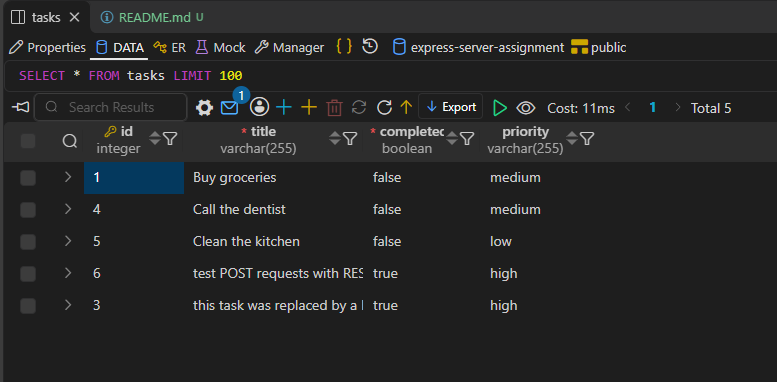

# Testing

`rest_client_test.http` uses the REST Client extension to test the backend.
With the extension installed, run the requests.

The responses from each request are saved under `./responses` as text files.

With the [postgreSQL](https://marketplace.visualstudio.com/items?itemName=cweijan.vscode-postgresql-client2)
extension, you can view the table and data in VSC, or register the db and view it in pgAdmin.

Row data after testing

## NOTE

Since the tests are hardcoded, running some tests more than once may return
a 4xx response such as trying to delete a task that's already been deleted/doesn't exist