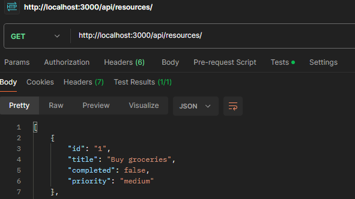
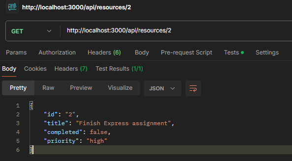
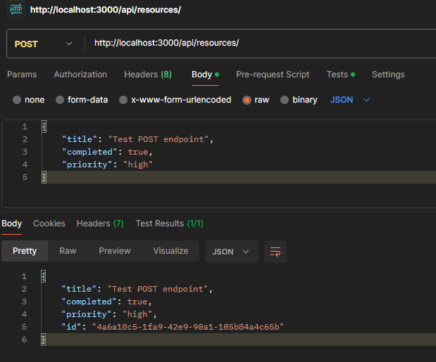
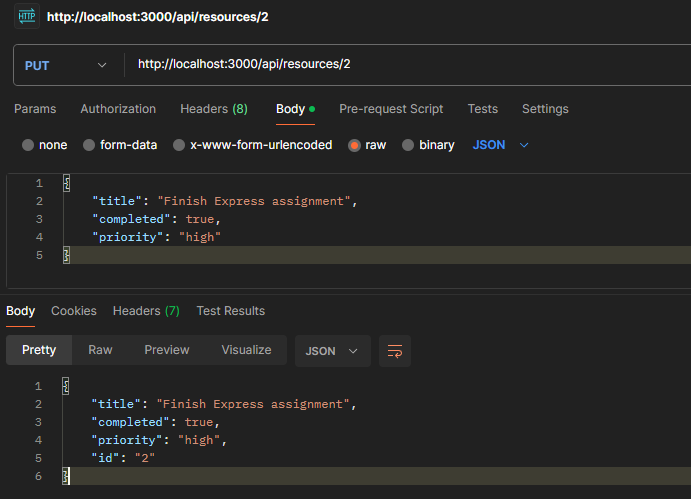
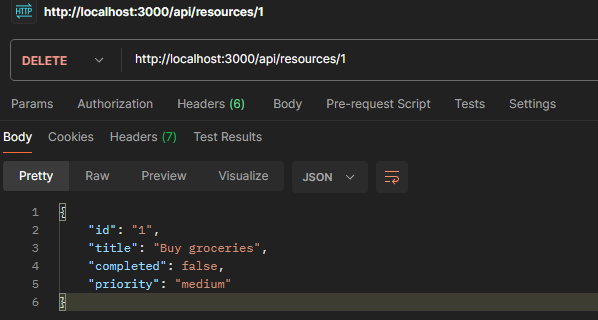

# Testing the API with Postman

## GET all tasks

GET http://localhost:3000/api/resources/
Status returned: 200
```json
[
    {
        "id": "1",
        "title": "Buy groceries",
        "completed": false,
        "priority": "medium"
    },
    {
        "id": "2",
        "title": "Finish Express assignment",
        "completed": false,
        "priority": "high"
    },
    {
        "id": "3",
        "title": "Walk the dog",
        "completed": true,
        "priority": "low"
    },
    {
        "id": "4",
        "title": "Call the dentist",
        "completed": false,
        "priority": "medium"
    },
    {
        "id": "5",
        "title": "Clean the kitchen",
        "completed": false,
        "priority": "low"
    }
]
```



## GET a specific task

GET http://localhost:3000/api/resources/2
Status returned: 200

```json
{
    "id": "2",
    "title": "Finish Express assignment",
    "completed": false,
    "priority": "high"
}
```



## POST a new task

POST http://localhost:3000/api/resources/
Status returned: 201

This is the request that was sent
```json
{
    "title": "Test POST endpoint",
    "completed": true,
    "priority": "high"
}
```

This is the response where the server accepted it and assigned an id
```json
{
    "title": "Test POST endpoint",
    "completed": true,
    "priority": "high",
    "id": "4a6a18c5-1fa9-42e9-90a1-105b84a4c65b"
}
```



## PUT a task

Before, all the tasks from the GET request
```json
[
    {
        "id": "1",
        "title": "Buy groceries",
        "completed": false,
        "priority": "medium"
    },
    {
        "id": "2",
        "title": "Finish Express assignment",
        "completed": false,
        "priority": "high"
    },
    {
        "id": "3",
        "title": "Walk the dog",
        "completed": true,
        "priority": "low"
    },
    {
        "id": "4",
        "title": "Call the dentist",
        "completed": false,
        "priority": "medium"
    },
    {
        "id": "5",
        "title": "Clean the kitchen",
        "completed": false,
        "priority": "low"
    }
]
```

Then PUT http://localhost:3000/api/resources/2 with
```json
{
    "title": "Finish Express assignment",
    "completed": true,
    "priority": "high"
}
```

The response is 200 where the id was kept the same but the
completed status was updated to true.
```json
{
    "title": "Finish Express assignment",
    "completed": true,
    "priority": "high",
    "id": "2"
}
```



## DELETE request

test by deleting task 1

DELETE http://localhost:3000/api/resources/1
status code: 200

response
```json
{
    "id": "1",
    "title": "Buy groceries",
    "completed": false,
    "priority": "medium"
}
```



Then run GET http://localhost:3000/api/resources/ to see task 1 was deleted properly

response
```json
[
    {
        "title": "Finish Express assignment",
        "completed": true,
        "priority": "high",
        "id": "2"
    },
    {
        "id": "3",
        "title": "Walk the dog",
        "completed": true,
        "priority": "low"
    },
    {
        "id": "4",
        "title": "Call the dentist",
        "completed": false,
        "priority": "medium"
    },
    {
        "id": "5",
        "title": "Clean the kitchen",
        "completed": false,
        "priority": "low"
    }
]
```